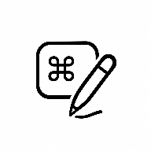

# PencilLink · 笔键联动



**轻按，继续。** 用手写笔操作键切换抖音视频、双击点赞，或继续不背单词复习。

**贡献者：[@moshanghua1227](https://github.com/moshanghua1227) · Codex（OpenAI AI 编程助手，开发贡献者）**

[下载 v0.3.1 APK](https://github.com/moshanghua1227/PencilLink/releases/download/v0.3.1/PencilLink-0.3.1.apk) · [版本发布页](https://github.com/moshanghua1227/PencilLink/releases/tag/v0.3.1) · [版本记录](CHANGELOG.md) · [贡献说明](CONTRIBUTORS.md) · [隐私说明](PRIVACY.md)

## 系统环境与验证状态

| 项目 | 说明 |
| --- | --- |
| 使用设备 | OPPO Pad Mini + OPPO Pencil 3（项目发起者提供） |
| 平板系统 | **ColorOS 17.0**（用户报告） |
| 安卓版本 | **Android 17**（用户报告，未自动读取设备核实） |
| 实机反馈 | 用户已确认抖音双击点赞、不背单词复习操作可用；早期反馈也显示短按可切视频 |
| 最低安装版本 | Android 8.0 / API 26，仅为清单配置，不代表所有系统均已实测 |
| 编译与目标 SDK | compileSdk 35 / targetSdk 35（Android 15 API），不是实机系统版本 |
| 电脑端验证 | 原生 Java 编译、APK v2/v3 签名校验、29 项时序和复习策略断言 |

这是面向上述设备场景的早期版本。实机可用反馈来自项目发起者，不代表对其他 OPPO 设备、其他 Android/ColorOS 版本或第三方应用后续更新的兼容承诺。Pencil 3 的按键能否转发仍取决于系统，安装后请先录入验证。

0.3.1 将用户提供的“命令键与斜置触控笔”图片设为应用图标，保留原图黑白样式，提供五档密度及 Android 自适应图标。功能与 0.3.0 相同。安装包为 `PencilLink-0.3.1.apk`，沿用旧版签名，可覆盖安装。

面向 OPPO Pad Mini / Pencil 3 的原生 Android 应用，非 OPPO 官方应用，与抖音、不背单词也无官方关联。使用 Android 无障碍服务；应用不具备远程控制平板的能力。

## 本版变化

- 界面使用浅雾蓝、白色、灰蓝文字。首页显示状态与总开关，详细设置分为四个子菜单，支持页面返回与旋转恢复当前菜单。
- 修正双击识别：默认第一次松开后等待 450 ms；若第二次按下发生在窗口内，就暂停第一次上滑，等第二次短按松开后点赞，避免在第二次按键期间提前切视频。单击/双击选择逻辑使用 Android uptime，不受系统日期调整影响。
- 抖音设置可调整识别窗口 250–800 ms，默认 450 ms。数值越大，双击越宽松，单击等待越久。抖音上滑手势本身保持 120 ms。
- 保留不背单词“认识”和“下一个”的短按功能。

## 安装与菜单

将 `PencilLink-0.3.1.apk` 传到平板覆盖安装；使用与上一版相同的包名和本地测试签名，保留原有配置。升级后若服务没有响应，关闭并重新开启系统无障碍服务。

首页打开联动总开关，设置项位于以下子页面：

| 子菜单 | 内容 |
| --- | --- |
| 连接与按键 | 阅读权限说明、开启无障碍、15 秒按键录入、实时事件状态 |
| 抖音 | 单击/双击说明、识别时间滑块、恢复默认值、测试设置入口 |
| 不背单词 | 配置“认识”和“下一个”文字、坐标备用方案 |
| 高级与诊断 | 测试浮窗、包名配置、事件诊断、关闭所有联动 |

首次使用：先在系统配对手写笔，再进入“连接与按键”，开启无障碍服务并录入一次笔键。若系统提示“受限设置”，在应用信息中按系统提示允许。系统入口可能因版本不同而变化。

## 抖音

在全屏视频页短按一次，等待双击窗口结束后上滑切下一个视频。两次短按之间，第二次按下在第一次松开后 450 ms 内（默认值），则仅发送视频中央的双击点赞手势，不上滑。不点击可能取消点赞的心形按钮；程序只能确认手势是否完成，不能确认服务器端点赞状态。

如果双击仍被识别为两次切视频：进入“抖音”，把识别时间调整到 600–800 ms 再试。连续切视频的两次按键应间隔大于所设窗口。长按超过 450 ms 不执行动作；第二次长按也不会触发待定上滑或点赞。

抖音最短动作间隔 220 ms；手势执行中不叠加动作。单击的等待是为了区分双击，不能在第一次按下时立即上滑再保证双击不切视频。

只在全屏视频页使用。程序按包名限制范围，未实现视频页面识别；评论、私信、搜索页面也属于抖音。可在“高级与诊断”开启浮窗，使用“测试抖音点赞”单独验证点赞动作。

## 不背单词

1. 复习页有“认识”时，短按精确匹配并点击“认识”。不匹配“不认识”。
2. 页面没有“认识”而显示“下一个”时，再短按点击“下一个”。一次短按只执行一步，不自动连点。
3. 如果实际按钮显示“下一词”等文字，在“不背单词”子菜单修改对应完整文字并保存。

同名匹配多个控件时跳过，避免盲点。最短动作间隔 400 ms。优先点击可点击的控件；必要时点击控件中心。

文字完全识别不到时，可在“高级与诊断”开启浮窗，到复习页点击“校准‘认识’位置”，再点一次按钮中心。此次触摸只记录位置，不点击底层按钮。然后在“不背单词”页面打开坐标备用开关。两个文字都找不到时才使用坐标，有歧义时不用坐标。

只存一个坐标。只有“认识”和“下一个”位置相同时才适合一起使用；位置不同时请关闭坐标模式并使用文字查找。坐标模式不能识别复习页面，在该应用其他页面按键可能误点。旋转、分屏、显示大小或布局变化后重新校准。程序会拒绝屏幕尺寸或方向与校准时不一致的坐标。

## 应用匹配与诊断

默认包名（请核对实际安装版本）：

- 抖音：`com.ss.android.ugc.aweme`
- 不背单词：`cn.com.langeasy.LangEasyLexis`

极速版、国际版等需要修改。开启浮窗后，可在目标应用用“查看前台包名”复制，回到“高级与诊断”粘贴并保存。

浮窗能动作而笔键不行时，优先检查按键信号；浮窗也不行时，核对服务、包名、按钮文字和当前页面。键码按 keyCode + scanCode 匹配；每次按下和松开必须来自相同输入设备。电源、Home、返回等系统键不允许录入。音量键可用于对照测试，但被录入后会在目标应用变成联动键；测试完成应重新录入笔键。

如其他按键能收到而 Pencil 3 始终没有事件，可能是厂商拦截或私有通道；本项目不假装支持未收到的信号。未实现厂商 SDK、root、Shizuku 或蓝牙私有协议。手写笔悬停/接触产生的触摸事件不等于全局按键。若系统清理服务，可检查系统允许的后台运行设置。

## 隐私与停用

无 INTERNET 权限，不上传内容。无障碍服务读取前台包名与控件、接收允许的按键，并模拟点击和手势；不截图、不录屏、不保存页面。配置在应用私有目录，最近按键诊断在内存。

首页可关闭联动；高级菜单可关闭全部联动和浮窗。完全停用请在系统无障碍设置关闭服务，或卸载应用。

## 构建与测试

Android Studio 打开本目录。需要 JDK 17、SDK Platform 35、AGP 8.9.2 和 Gradle 8.11.1；已包含官方 Gradle Wrapper，并配置发行包 SHA-256 校验。首次构建会下载 Gradle 和构建依赖。[AGP 与 Gradle 版本对应说明](https://developer.android.com/build/releases/agp-8-9-0-release-notes) / [Gradle Wrapper 说明](https://docs.gradle.org/current/userguide/gradle_wrapper.html)。

```powershell
./gradlew.bat :app:assembleDebug
./tests/run-tests.ps1 -JavaHome 'C:/path/to/jdk17'
```

标准 Gradle 构建 APK 位于 `app/build/outputs/apk/debug/app-debug.apk`，使用构建机器的调试签名，通常与已发布 APK 不同，不能直接覆盖后者。仓库不包含发布密钥。当前发布附件仍由已实际验证的无 Gradle 构建脚本生成；Gradle 构建入口尚未在本次环境完整运行。

不使用 Gradle 时，提供 `build-apk.ps1`：

```powershell
./build-apk.ps1 -JavaHome 'C:/path/to/jdk17' -AndroidJar 'C:/path/to/android-35/android.jar' -BuildTools 'C:/path/to/build-tools/35.0.0'
```

中间文件及本地测试密钥默认放到源码目录两级上方的 `work/PencilLinkBuild`，APK 放到源码旁。可用 `BuildDir`、`OutputApk` 修改。分发应自行管理正式签名，覆盖安装需保持同一签名。

`tests/PressResolverTest.java` 是不依赖 Android 的时序回归测试，与 `ActionPolicy.java`、`PressResolver.java` 一起用 javac 编译运行。29 项断言涵盖第二次按下暂停单击、第二次松开时确认双击、单击只执行一次、超时、长按/取消、窗口边界、切应用取消、按钮优先级与歧义保护。它验证决策逻辑，不代表真机按键或 UI 已通过测试。

实现参考：[AccessibilityService](https://developer.android.com/reference/android/accessibilityservice/AccessibilityService) 与 [AccessibilityServiceInfo](https://developer.android.com/reference/android/accessibilityservice/AccessibilityServiceInfo)。系统能力不保证厂商向第三方转发每一种笔按键。

## 贡献与问题反馈

项目发起、需求设计及实机反馈：[@moshanghua1227](https://github.com/moshanghua1227)。开发协助：**Codex（OpenAI AI 编程助手）**。详细分工见 [CONTRIBUTORS.md](CONTRIBUTORS.md)。

提交问题时请提供平板型号、ColorOS 与 Android 版本、应用版本、当前页面、能否录入按键，以及浮窗动作测试是否成功。不要提交邮箱、账号、密码或包含私人页面的完整日志。
